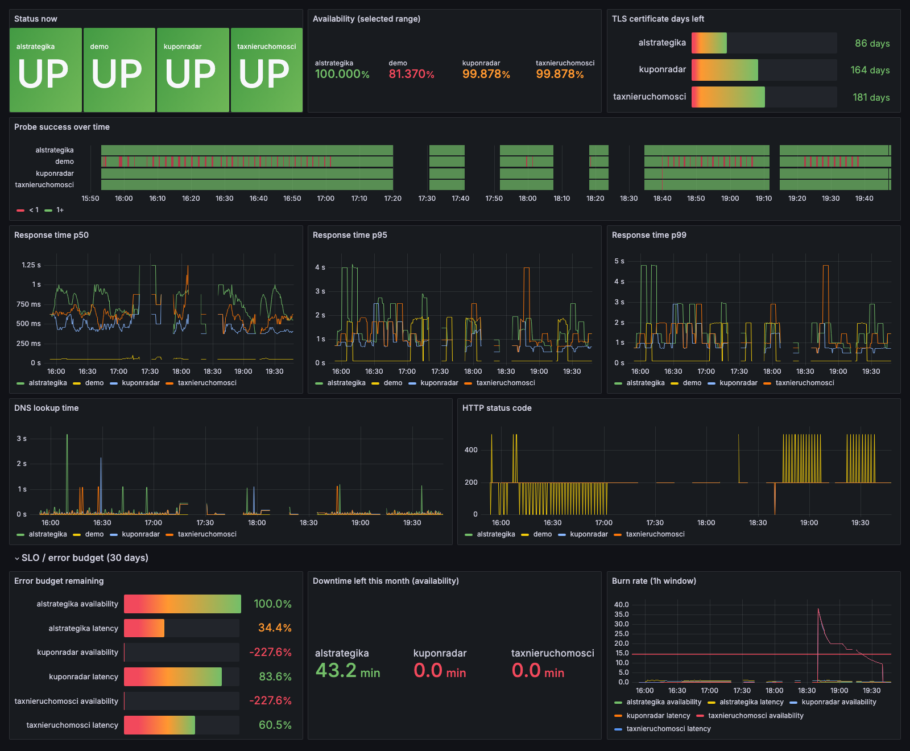
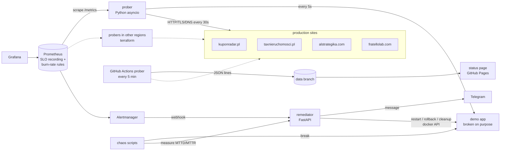

# sitewatch

[](https://github.com/swiadre/sitewatch/actions/workflows/ci.yml)
[](https://github.com/swiadre/sitewatch/actions/workflows/probe.yml)

**Live status page: https://swiadre.github.io/sitewatch/**

Monitoring + SLOs + auto-remediation for 4 real production sites, built to learn how
Google-style SRE works in practice (SLIs/SLOs, error budgets, burn-rate alerts, chaos testing).

- probes **kuponradar.pl**, **taxnieruchomosci.pl**, **alstrategika.com** and **fratellolab.com** every 30 s (HTTP, TLS, DNS)
- Prometheus + Grafana dashboards, **SLOs with error budgets** and **multi-window burn-rate alerts**
- alerts go to Telegram through a small **remediator** service that also **fixes known failures by itself**
  (restart, rollback, disk cleanup) with safety limits
- **chaos tests** for 5 failure scenarios measure MTTD / MTTR with and without auto-remediation
- **24/7 probes from GitHub Actions** every ~5 min + a public [status page](https://swiadre.github.io/sitewatch/)
  with 30-day availability, error budget and incidents (works even when my laptop is off)
- runs on **Kubernetes** too (local kind cluster): least-privilege RBAC for the remediator,
  liveness probes, and the same chaos tests to compare Docker vs Kubernetes
- infrastructure as code (Terraform, GCP) + CI/CD (GitHub Actions)



<sub>First ~4 hours of data, from my laptop. Gaps = laptop asleep, red stripes on "demo" = chaos
tests. The negative error budget for 2 sites is from **one** failed probe right after the laptop
woke up, counted against only 4 hours of data. It also caused a false page, see the
[postmortem](postmortems/2026-10-19-false-page-after-laptop-wake.md).</sub>

## Results

Chaos tests on the demo app: 5 failure scenarios × 10 runs each, **with auto-remediation**
([details + raw data](chaos/README.md)):

| scenario | mode | runs | recovered | MTTD mean | MTTD median | MTTR mean | MTTR median | MTTR max |
|---|---|---|---|---|---|---|---|---|
| kill | auto | 10 | 10/10 | 18.4 s | 18.4 s | 18.6 s | 18.6 s | 19.1 s |
| hang | auto | 10 | 10/10 | 23.5 s | 23.4 s | 23.9 s | 23.9 s | 24.3 s |
| latency | auto | 10 | 10/10 | 22.7 s | 22.4 s | 23.2 s | 22.9 s | 24.8 s |
| disk | auto | 10 | 10/10 | 17.6 s | 17.6 s | 17.8 s | 17.6 s | 18.1 s |
| bad_deploy | auto | 10 | 10/10 | 23.0 s | 23.1 s | 23.5 s | 23.7 s | 24.0 s |

- **50/50 failures fixed automatically**, mean time to recovery **21.4 s**, worst case 24.8 s
- MTTR is only ~0.4 s more than MTTD, so **almost all of the recovery time is detection**.
  The fix itself (restart / rollback / cleanup) takes well under a second. To go faster I'd
  need faster detection (shorter probe interval and `for:`), at the cost of more false alarms
- **on Kubernetes**, crashes and hangs were fixed by the platform itself (pod replaced in
  0.7 s on average, liveness probe at ~15 s), faster than my remediator. Bad deploys, full disks
  and network latency still needed it ([comparison](chaos/README.md#docker-vs-kubernetes))
- the repeated runs found **2 bugs in my own alerting pipeline** (Alertmanager grouping
  added 10-20 s, a 15 s scrape interval delayed bad-deploy detection), both fixed
  ([what happened](chaos/README.md#what-the-chaos-tests-found-bugs-in-my-own-setup))
- I didn't measure MTTR **without** automation (a human fixing it by hand), so there's no
  before/after number here. The runner supports it (`--mode manual`), see
  [chaos/README.md](chaos/README.md#running)

## Architecture



| folder | what's inside |
|---|---|
| [`prober/`](prober/) | async probes (HTTP status + content, response time, TLS expiry, DNS), Prometheus metrics |
| [`slo/`](slo/) | SLO definitions, error budget math, generator for burn-rate rules. **[Why these SLOs →](slo/README.md)** |
| [`remediation/`](remediation/) | Alertmanager webhook → Telegram + automatic fixes, rate limited |
| [`demo/`](demo/) | tiny app used as a target for remediation and chaos tests |
| [`chaos/`](chaos/) | failure scenarios + MTTD/MTTR measurement. **[Details →](chaos/README.md)** |
| [`deploy/`](deploy/) | docker compose, Prometheus rules + promtool unit tests, Alertmanager, Grafana dashboard JSON |
| [`k8s/`](k8s/) | the same stack on a local Kubernetes (kind) cluster, RBAC for the remediator. **[Details →](k8s/README.md)** |
| [`terraform/`](terraform/) | GCP: main VM, probers in 2 more regions, firewall, optional DNS |
| [`statuspage/`](statuspage/) | builds the static status page from the probe data in the [`data`](https://github.com/swiadre/sitewatch/tree/data) branch |
| [`postmortems/`](postmortems/) | blameless postmortems of real incidents |

## Design decisions (short version)

- **Availability = HTTP only.** A cert expiring in 10 days or a slow DNS lookup isn't downtime
  for users, so they get their own alerts instead of eating the error budget.
- **Content check.** A suspended-hosting page also returns 200, so every site has an
  expected text that must be on the page.
- **Burn-rate alerts, not "alert on every error".** One failed probe never pages anyone
  (tested with `promtool test rules`). A full outage pages in ~1 min, slow
  degradation opens a ticket.
- **Latency SLO is based on data, not wishes.** I wanted "95% < 500 ms", measured, and
  saw it would be broken from day one. It's 90% < 1.5 s for now ([details](slo/README.md#latency-90-of-responses-under-15-s)).
- **Auto-remediation has a budget too.** Max 3 actions per hour + a 2 min cooldown per
  action. After that it stops and tells a human, so a bad fix can't loop forever.
- **Chaos only on the demo app.** I don't own the hosting of the real sites, and breaking
  production on purpose for a portfolio project would be a bad idea anyway.

## Running it

Needs Docker and Python 3.12.

```bash
cd deploy
cp .env.example .env          # optional: telegram bot token + chat id
docker compose up -d --build
```

| | |
|---|---|
| Grafana | http://localhost:3000 (dashboard "sitewatch - overview") |
| Prometheus | http://localhost:9090 |
| Alertmanager | http://localhost:9093 |
| remediator | http://localhost:9000/status, `/events` |
| demo app | http://localhost:8081 |

If port 3000 is taken: `GRAFANA_PORT=3001 docker compose up -d`.

Telegram alerts:
1. create a bot with [@BotFather](https://t.me/BotFather) (`/newbot`) and put the token into
   `deploy/.env` as `TELEGRAM_BOT_TOKEN=...`
2. open your new bot in Telegram and send it `/start`
3. `python -m remediation.telegram_setup` finds your chat id, saves it to `deploy/.env` and
   sends a test message
4. `cd deploy && docker compose up -d remediator`

Without a token the remediator just prints the messages to its log.

24/7 probes: GitHub's own cron skips most scheduled runs in this repo (1 run in 8 hours on day 1),
so the probe workflow is also started every 5 minutes by a free external cron
([cron-job.org](https://cron-job.org)) through the GitHub API (`POST .../actions/workflows/probe.yml/dispatches`)
with a fine-grained token that can only run workflows in this repo.

Only the prober, without Docker:

```bash
python3.12 -m venv .venv && source .venv/bin/activate
pip install -r requirements-dev.txt
python -m prober --once
```

## Tests

```bash
pytest                 # python unit tests
ruff check .
# alert rule unit tests (also run in CI):
docker run --rm --entrypoint promtool -v "$PWD/deploy/prometheus:/p:ro" -w /p/tests \
  prom/prometheus:v2.54.1 test rules slo_test.yml
```

CI runs ruff, pytest, `promtool check` + `promtool test rules`, `amtool check-config` and
`terraform validate` on every push. After CI passes on `main`, images are built and pushed
to GHCR. The deploy step to GCP is ready but switched off until the GCP project exists.

## Known limitations / what I'd do differently

- the Docker setup (Prometheus, alerts, auto-remediation) runs **on my laptop**, so it only
  works while the laptop is awake. The always-on part is the GitHub Actions prober, and that's
  what the status page and the 30-day numbers come from. GitHub's cron is best effort
  (runs can be late or skipped), so it's ~5-15 min resolution, not 30 s
- the GCP setup (Terraform: always-on VM + probers in 2 more regions) is written and validated
  in CI but **not deployed**, because I didn't want to pay for it
- in docker compose the remediator talks to the Docker socket, which is root on the host.
  The [Kubernetes version](k8s/) fixes that with a ServiceAccount that can only delete pods and
  patch one deployment in one namespace
- SLO windows need weeks of data to be meaningful. In the first hours a single failure looks
  much bigger than it is. This caused a real false page, now prevented by a minimum-data
  guard ([postmortem](postmortems/2026-10-19-false-page-after-laptop-wake.md))
- **at 1000 sites instead of 3:** generated rules per site would explode (that's ~24 rules
  per site). I'd switch to one set of rules with `by (site)` and the objective as a recording
  rule joined in. Probers would be sharded by site hash, and Prometheus would need
  federation or something like Thanos/Mimir
